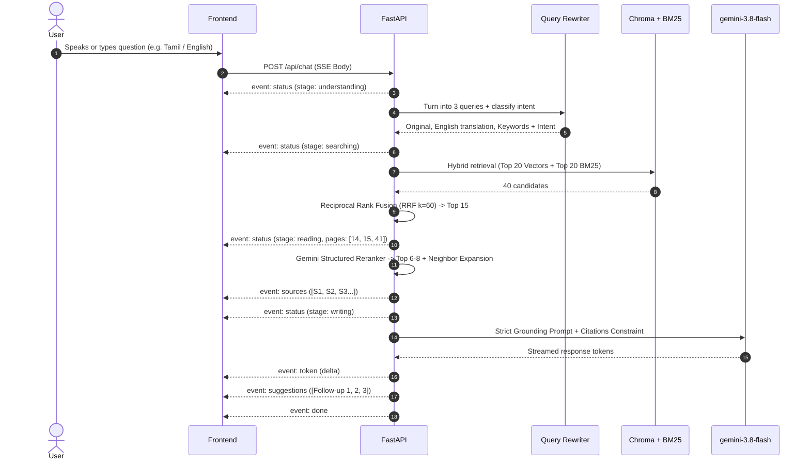

# KSRCE Handbook Assistant - System Architecture

## 1. System Overview

The **KSRCE Handbook Assistant** is an enterprise-grade, multilingual, voice-enabled Retrieval-Augmented Generation (RAG) platform. It provides accurate, strictly grounded answers to student and staff queries regarding academic regulations, curriculum structures, attendance condonation, examinations, fees, and hostel rules.

```mermaid
graph TD
    subgraph Client ["Frontend (React 18 + TS + Vite + Tailwind + Framer Motion)"]
        UI[Glassmorphic Chat UI]
        STT_Dual[Dual STT: Web Speech API / Gemini Audio]
        TTS_Dual[Dual TTS: Gemini Flash TTS / Web Speech]
        IndexedDB[Offline Storage: Dexie IndexedDB]
    end

    subgraph Gateway ["FastAPI Gateway & Lifespan Controller"]
        Router[API Endpoints & SSE Streaming]
        RateLimiter[Slowapi Rate Limiter]
        Cache[LRU Query & Embeddings Cache]
    end

    subgraph RAG_Pipeline ["Autonomous RAG Pipeline"]
        Rewriter[Multi-Query Rewriter & Intent Classifier]
        HybridSearch[Hybrid Retrieval: BM25 + ChromaDB Cosine]
        RRF[Reciprocal Rank Fusion k=60]
        Reranker[Gemini Structured Reranker 0-10]
        Grounding[Strict Grounding Prompt & Inline Citations S1, S2]
        Generator[gemini-3.8-flash Streaming Engine]
    end

    subgraph Knowledge_Base ["Persistent Knowledge Layer"]
        PDFs[(Data/ *.pdf Auto-Discovery)]
        Extractor[PyMuPDF4LLM Markdown + Vision OCR]
        ChromaStore[(ChromaDB Vector Store)]
        BM25Store[(BM25 Okapi Index)]
    end

    UI -->|SSE Request| Router
    Router --> Rewriter
    Rewriter --> HybridSearch
    HybridSearch --> ChromaStore
    HybridSearch --> BM25Store
    ChromaStore & BM25Store --> RRF
    RRF --> Reranker
    Reranker --> Generator
    Generator -->|Streaming Tokens & [S1] Sources| UI
```

---

## 2. Ingestion & Indexing Pipeline

1. **Auto-Discovery:** The loader automatically discovers every `*.pdf` in the `Data/` directory using Windows-safe path deduplication (`p.resolve()`), without hardcoding document filenames.
2. **Page-by-Page Extraction:** `pymupdf4llm` extracts full markdown representations preserving headers, bullet hierarchies, and structured tables. Pages with little or no extractable text trigger Gemini Vision OCR fallback.
3. **Markdown Cleaner:** Strips institutional headers, footers, and page number noise while repairing hyphenated line breaks (`re- quirement` -> `requirement`) and ensuring numbered regulation lists stay intact.
4. **Structure-Aware Chunking:** Splits chunks by markdown headings and paragraphs into 500–800 token blocks with 120 token overlap. Tables and numbered rules are kept strictly atomic without mid-row cuts.
5. **Contextual Embeddings:** Prepends section breadcrumbs (`{doc_title} > {section_path}\n{chunk_text}`) and generates high-dimensional embeddings via `gemini-embedding-001` (3072 dimensions) with batching and persistent disk caching.
6. **Dual Index Storage:**
   - **Vector Store:** ChromaDB persistent collection using cosine distance.
   - **Lexical Index:** BM25Okapi serialized index for precise keyword and rule-number matching.

---

## 3. Retrieval & Generation Pipeline



---

## 4. Multilingual & Voice Architecture

1. **Multilingual In/Out:**
   - 12 Indic regional languages + English supported (`en`, `ta`, `hi`, `te`, `ml`, `kn`, `bn`, `mr`, `gu`, `pa`, `ur`, `or`).
   - Cross-lingual retrieval translates queries into English search queries under the hood, but responses are streamed directly in the target language.
2. **Dual-Path Speech-to-Text:**
   - **Path A:** Browser Web Speech API for zero latency with matching locale (`ta-IN`, `hi-IN`, `te-IN`, etc.).
   - **Path B:** MediaRecorder -> Gemini Multimodal Audio transcription (`POST /api/stt`) for cross-browser fallback and auto-detection.
3. **Dual-Path Text-to-Speech:**
   - **Path A:** Server-side `gemini-3.8-flash-tts` synthesis returned as streaming WAV audio.
   - **Path B:** Browser `speechSynthesis` fallback with barge-in support (starting the microphone stops ongoing playback immediately).

---

## 5. Security & Grounding Guarantees

- **Strict Negative Constraints:** The system prompt instructs Gemini to formulate responses *solely* from the injected context blocks. If the question cannot be answered from the handbook, it declines politely and highlights related handbook sections.
- **Anti-Prompt Injection:** Handbook text is treated strictly as data within delimited boundaries, preventing system prompt extraction or override.
- **Zero Frontend Secrets:** `GEMINI_API_KEY` is read strictly from `backend/.env` and never transmitted to the browser or logged in plaintext.
